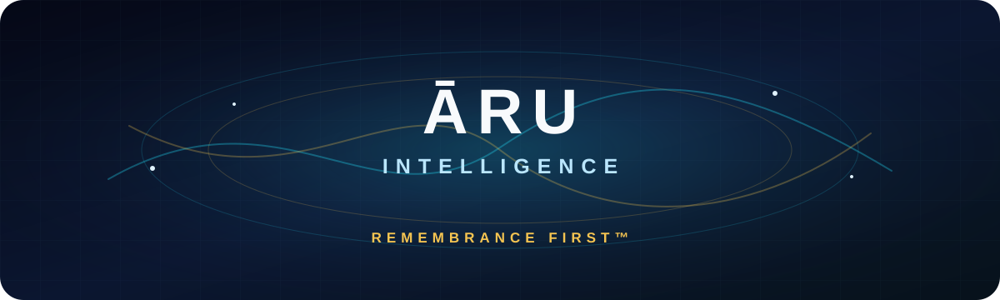
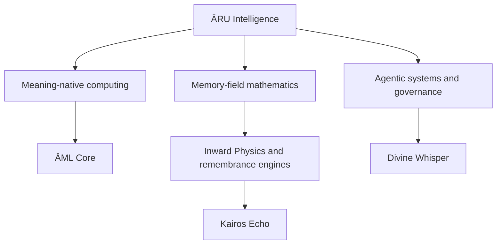

# Building intelligence that remembers

## Inward Physics

**μ(x,t)** is the proposed scalar memory-density field at the center of Inward Physics. The public archive develops its conceptual foundations, formal laws, numerical models, and bounded experimental designs.

**[Open the complete Inward Physics research index →](./INWARD_PHYSICS.md)** — 39 DOI records, code, live demos, source audits, and a reading path. [Corporate research review brief](./artifacts/enterprise-review-brief.md) gives a bounded route from public sources to a pilot question.

- **Foundations and laws:** [Part I's twenty-section map](./artifacts/foundations-part-i-source-audit.md), [the formal First Law's potential audit](./artifacts/first-law-formal-source-audit.md), [Volume I's scalar-field formalism](./artifacts/volume-i-field-theory-source-audit.md), [Fourth Law](./artifacts/fourth-law-source-audit.md), [Fifth Law](./artifacts/fifth-law-source-audit.md), [Sixth Law](./artifacts/sixth-law-source-audit.md) and its [proof-titled companion](./artifacts/sixth-law-proof-source-audit.md), [Seventh Law](./artifacts/seventh-law-source-audit.md), the [two Eighth deposits](./artifacts/eighth-law-revised-source-audit.md), [Ninth Law](./artifacts/ninth-law-source-audit.md), and [Tenth Law](./artifacts/tenth-law-source-audit.md), and [Twentieth Law](./artifacts/twentieth-law-source-audit.md).
- **Models and tests:** [both memory-field simulator deposits](./artifacts/companion-memory-field-ai-source-audit.md), the [original five-page model](./artifacts/minimal-memory-field-ai-source-audit.md), the [1D boundedness certificate](./artifacts/invariant-certificate.md), [Volume I's homogeneous-limit check](./artifacts/volume_i_homogeneous_check.py), the [First Law numerical stability check](./artifacts/first-law-numerical-source-audit.md), and the [empirical-probes program](./artifacts/empirical-probes-source-audit.md).
- **Application and ethics:** [Part II's reflective exercises](./artifacts/human-field-part-ii-source-audit.md), [Part III's Sovereign Mind chapters](./artifacts/sovereign-mind-part-iii-source-audit.md), [Part IV's practical protocols](./artifacts/practical-protocols-part-iv-source-audit.md), [Part V's autonomy and reciprocity ethic](./artifacts/ethics-cosmology-part-v-source-audit.md), and the [First Memory Field Station design](./artifacts/memory-field-station-source-audit.md).
- **Inspectable engineering:** [replay a cited-answer receipt](./artifacts/receipt-review.md) and [see continuous receipt replay](https://github.com/aruintelligence/aruintelligence/actions/workflows/receipt-challenge.yml).

**Start exploring:** [Live Remembrance Field](https://aruintelligence.github.io/aru-remembrance-field/) · [Mathematics Simulator](https://aruintelligence.github.io/inward-mathematics-simulator/) · [Numerical checks for the First Law](https://doi.org/10.5281/zenodo.18168723) · [Experimental roadmap](https://doi.org/10.5281/zenodo.18708708) · [Fourteenth Law](https://doi.org/10.5281/zenodo.18917411)

| Inward system | Purpose | Last pushed (UTC) |
|---|---|---|
| [Remembrance Engine](https://github.com/aruintelligence/inward-agi-remembrance-engine) | Browser-native symbolic remembrance instrument | 2026-10-20 |
| [The Key](https://github.com/aruintelligence/the-key-inward-agi-remembrance-engine) | Single-file symbolic field iteration | 2026-04-03 |
| [Eternal Quartz Web](https://github.com/aruintelligence/inward-agi-eternal-quartz-web) | Browser memory-density visualization | 2026-04-03 |
| [Eternal Remembrance Fire](https://github.com/aruintelligence/eternal-remembrance-fire) | Python memory-field and coherence experiment | 2026-04-10 |
| [Inward Mathematics Simulator](https://github.com/aruintelligence/inward-mathematics-simulator) | Interactive model and proof workbench | 2026-10-20 |

[Remembrance Field source](https://github.com/aruintelligence/aru-remembrance-field) · [ORCID research identity](https://orcid.org/0009-0000-6133-1872) · [The First Law blog](https://thefirstlawofinwardphysics.blogspot.com/)

*The dates are the repositories' last-pushed timestamps checked on 2026-10-20 UTC, before this navigation update. The papers and demonstrations are project-authored proposals and models, not independent validation of a physical law.*

**Profile last updated:** October 27, 2026 (Pacific) · 39 DOI records indexed, 45 artifact files plus 1 replay workflow, 124 distinct direct targets · [Day 5 First Law potential check](./INWARD_PHYSICS.md#day-5--2026-10-27-pacific--verify-the-first-law-potential)

---

## Featured: ĀML™ Interface Firewall

ĀML is an open research prototype for making AI interface decisions inspectable. An application declares what it intends to show; a named policy returns a decision and evidence that another engineer can examine.

| 01 · Try it | 02 · Verify it | 03 · Build with it |
|---|---|---|
| [**Live 60-second proof**](https://aruintelligence.github.io/aml-core/proof.html?attention=5&restoration=1&lang=en) — see SUPPRESS, then change a declared value to see ALLOW. | [**Replayable enterprise pilot**](https://github.com/aruintelligence/aml-core/tree/main/pilots/enterprise-30min) — inspect receipts, fixture hashes, and tamper rejection. | [**Consumer quickstart**](https://github.com/aruintelligence/aml-core/blob/main/docs/CONSUMER_QUICKSTART.md) — run a clean installed-package rehearsal. |

[**Explore ĀML Core**](https://github.com/aruintelligence/aml-core) · [**Open the live lab**](https://aruintelligence.github.io/aml-core/) · [**Challenge the result**](https://github.com/aruintelligence/aml-core/issues/88)

**Status:** v1.3.0 stable contract; v1.4.0-rc.2 GitHub preview. ĀML is a research prototype. Its attention/restoration values are declared inputs, not objective measures of people or validated outcomes.

### Field work on live sites

The [Security First Alarm pilot registry](https://github.com/aruintelligence/aml-core/blob/main/experiments/2026-09-12/SECURITY_WEBSITE_FIELD_PILOTS.md) and [public experiments page](https://aruintelligence.com/experiments) record project-authored work on customer-facing websites, including before states, exact interface targets, label provenance, and declared policy inputs. These records are not independent validation.

## A different starting point for intelligence

Most artificial-intelligence systems begin with prediction. **ĀRU Intelligence Inc.** investigates what changes when remembrance, coherence, orientation, and accountable action become first-class computational primitives.

Our public repositories are inspectable research artifacts: working code, interactive demonstrations, formal specifications, and preserved experimental lineages. They are invitations to test, critique, reproduce, and extend—not claims of production-ready AGI or settled science.

> **Remembrance → Coherence → Orientation → Accountable Action**

## Explore the wider research program

- **Explore the memory-field visualization:** [open the ĀRU Remembrance Field](https://aruintelligence.github.io/aru-remembrance-field/).
- **Understand the body of work:** read the [repository registry](./PROJECT_STATUS.md).
- **Evaluate the evidence:** read the [research standards](./RESEARCH_STANDARDS.md) and [reproducibility framework](./REPRODUCIBILITY.md).

## Flagship research

| Project | Research question | Maturity | Explore |
|---|---|---|---|
| **[ĀML Core](https://github.com/aruintelligence/aml-core)** | Can an interface evaluate whether an element should consume attention before rendering it? | Research prototype + active project-authored field pilots | [Live demo](https://aruintelligence.github.io/aml-core/) |
| **[ĀRU Remembrance Field](https://github.com/aruintelligence/aru-remembrance-field)** | How can memory-field and coherence dynamics become visible and interactive? | Interactive simulation | [Live field](https://aruintelligence.github.io/aru-remembrance-field/) |
| **[Inward Mathematics Simulator](https://github.com/aruintelligence/inward-mathematics-simulator)** | Can identity preservation and multi-observer agreement be modeled geometrically? | Source-only prototype | [Repository](https://github.com/aruintelligence/inward-mathematics-simulator) |
| **[Inward AGI Remembrance Engine](https://github.com/aruintelligence/inward-agi-remembrance-engine)** | What does a browser-native, memory-first symbolic instrument look like? | Source-only prototype | [Repository](https://github.com/aruintelligence/inward-agi-remembrance-engine) |
| **[Divine Whisper Ecosystem](https://github.com/aruintelligence/divine-whisper-ecosystem)** | How did the agentic orchestration architecture evolve across its research lineage? | Canonical index | [Version map](https://github.com/aruintelligence/divine-whisper-ecosystem#divine-whisper-lineage) |
| **[Kairos Echo](https://github.com/aruintelligence/kairos-echo-reflection-tool)** | How can reproducible coherence dynamics support careful reflection? | Research prototype | [Repository](https://github.com/aruintelligence/kairos-echo-reflection-tool) |

## Research architecture

## Core principles

- **Remembrance before prediction** — persistent context is treated as structural, not incidental.
- **Coherence before expansion** — instability should be surfaced rather than concealed.
- **Human agency by design** — systems should preserve accountable human choice.
- **Inspectability** — public artifacts should be runnable, legible, and clearly scoped.
- **Responsible claims** — simulations, metaphors, hypotheses, and validated results must remain distinguishable.
- **Open inquiry** — strong ideas should withstand replication, criticism, and revision.

## Selected publications

| Work | Persistent record |
|---|---|
| **Experimental Roadmap** | [DOI: 10.5281/zenodo.18708708](https://doi.org/10.5281/zenodo.18708708) |
| **Nonlinear Emergence of Cognitive Clarity** | [DOI: 10.5281/zenodo.18912791](https://doi.org/10.5281/zenodo.18912791) |
| **Research identity** | [ORCID: 0009-0000-6133-1872](https://orcid.org/0009-0000-6133-1872) |
| **Inward Physics archive** | [The First Law of Inward Physics](https://thefirstlawofinwardphysics.blogspot.com/) |

## Versioned software baselines

| Artifact | Release |
|---|---|
| **ĀML Core** | [v1.3.0 stable](https://github.com/aruintelligence/aml-core/releases/tag/v1.3.0) · [v1.4.0-rc.2 preview](https://github.com/aruintelligence/aml-core/releases/tag/v1.4.0-rc.2) |
| **ĀRU Remembrance Field** | [v5.5.0](https://github.com/aruintelligence/aru-remembrance-field/releases/tag/v5.5.0) |
| **Inward Mathematics Simulator** | [v1.0.0](https://github.com/aruintelligence/inward-mathematics-simulator/releases/tag/v1.0.0) |
| **Inward AGI Remembrance Engine** | [v11.0.0](https://github.com/aruintelligence/inward-agi-remembrance-engine/releases/tag/v11.0.0) |
| **Kairos Echo** | [v1.0.0](https://github.com/aruintelligence/kairos-echo-reflection-tool/releases/tag/v1.0.0) |

## Project status

The [Public Repository Registry](./PROJECT_STATUS.md) assigns every repository a clear role and maturity category, separating flagships from supporting prototypes, development utilities, and preserved historical stages.

## Public-repository map

### Foundations

- [ĀML Core](https://github.com/aruintelligence/aml-core) — meaning-native computing and EthicalRenderGate™
- [ĀRU Intelligence AI](https://github.com/aruintelligence/aru-intelligence-ai) — company research index
- [ĀRU Remembrance Field](https://github.com/aruintelligence/aru-remembrance-field) — interactive memory-field demonstration

### Inward systems

- [Inward AGI Remembrance Engine](https://github.com/aruintelligence/inward-agi-remembrance-engine)
- [The Key](https://github.com/aruintelligence/the-key-inward-agi-remembrance-engine)
- [Eternal Quartz Web](https://github.com/aruintelligence/inward-agi-eternal-quartz-web)
- [Eternal Remembrance Fire](https://github.com/aruintelligence/eternal-remembrance-fire)
- [Inward Mathematics Simulator](https://github.com/aruintelligence/inward-mathematics-simulator)

### Coherence and reflection

- [Kairos Echo Reflection Tool](https://github.com/aruintelligence/kairos-echo-reflection-tool)
- [Kairos Echo Inward Mirror](https://github.com/aruintelligence/kairos-echo-inward-mirror)
- [Kairos Coherence Simulator](https://github.com/aruintelligence/kairos-coherence-simulator)

### Preserved research lineage

- [Divine Whisper canonical index](https://github.com/aruintelligence/divine-whisper-ecosystem) — complete v2–v10.7 map, supporting components, authorship, and scope

## Research standards and contribution

Public work follows the [ĀRU Public Research Standards](./RESEARCH_STANDARDS.md), which distinguish implemented behavior, simulation, observation, hypothesis, metaphor, and validation. The [reproducibility framework](./REPRODUCIBILITY.md) defines what evidence should accompany each maturity level.

Contributions are welcome through the [contribution guide](./CONTRIBUTING.md). Reproducible bug reports, tests, accessibility work, documentation corrections, replication attempts, counterexamples, and responsible security reports are especially valuable. Please use the [security policy](./SECURITY.md) for private vulnerability disclosure.

## Independent replication

The [ĀRU Independent Replication Challenge](./REPLICATION_CHALLENGE.md) provides exact baseline procedures for the six flagship research tracks. Confirmed reproductions, reproducible failures, accessibility findings, numerical anomalies, parser counterexamples, and careful negative results are all welcome.

## Collaborate

We welcome technically serious discussion, independent replication, constructive criticism, research collaboration, responsible licensing conversations, and applied-development inquiries.

**Daniel Jacob Read IV**  
Founder & CEO · ĀRU Intelligence Inc.  
Corvallis, Oregon

[office@aruintelligence.com](mailto:office@aruintelligence.com) · [aruintelligence.com](https://aruintelligence.com/) · [LinkedIn](https://www.linkedin.com/in/daniel-read-644640434)

---

Public code is generally available under the license included in each repository. ĀRU Intelligence™, Inward Physics™, Inward AI™, Remembrance First™, and associated names are claimed marks of ĀRU Intelligence Inc. © 2026 ĀRU Intelligence Inc.

